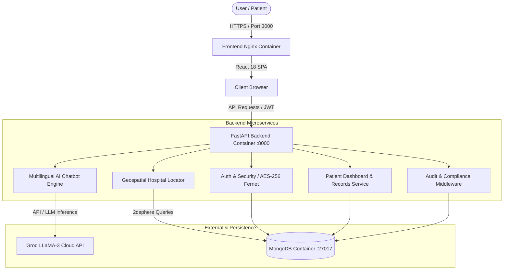

# HealthMitra 2.0 — System Architecture Document

## Overview

HealthMitra 2.0 is an enterprise-grade, multilingual, AI-powered healthcare triage and hospital navigation platform built specifically for rural and semi-urban Indian populations. It combines localized LLM medical guidance, geospatial hospital lookup with 2dsphere spatial indexing, and HIPAA-aligned security.

---

## High-Level System Architecture



---

## Technical Stack

| Layer | Technology | Key Capabilities |
|---|---|---|
| **Frontend** | React 18, TypeScript, TailwindCSS | Component-driven, responsive, accessible, Lucide icons |
| **State Management** | Zustand | Lightweight atomic stores (`useAuthStore`, `useChatStore`, `useLocationStore`) |
| **Routing & Code-Splitting** | React Router DOM v6, React `Suspense` + `lazy` | Route guards, error boundaries, on-demand bundle loading |
| **Mapping & Geospatial** | Leaflet, React-Leaflet | OpenStreetMap tiles, interactive pins, custom popups |
| **Backend API** | FastAPI (Python 3.11), Uvicorn | Async I/O, Pydantic v2 schemas, automated OpenAPI documentation |
| **Database** | MongoDB 7.0 + Motor (Async driver) | Document store, geospatial `2dsphere` index on GeoJSON coordinates |
| **Security & Auth** | OAuth2 Password Bearer, JWT, Passlib (Bcrypt), Cryptography (Fernet AES-256) | Role-Based Access Control (RBAC), password hashing, PHI field encryption |
| **Audit Logging** | Custom FastAPI Middleware | Non-repudiable audit logging for compliance |
| **Containerization** | Docker, Docker Compose, Alpine Nginx | Multi-stage production builds, isolated networking |

---

## Data Models & Schema Design

### 1. User (`users` collection)
- `_id`: ObjectId
- `email`: Indexed unique string
- `full_name`: User name
- `role`: Role string (`patient`, `doctor`, `admin`, `asha_worker`)
- `hashed_password`: Bcrypt-hashed password string
- `created_at` / `updated_at`: Timestamps

### 2. Hospital (`hospitals` collection)
- `_id`: ObjectId
- `name`: Hospital name
- `hospital_type`: `government`, `private`, `speciality`, `multispeciality`
- `address`: Detailed street address
- `location`: GeoJSON `Point` (`{"type": "Point", "coordinates": [longitude, latitude]}`) — indexed with `2dsphere`
- `contact`: Contact phone number
- `services`: Array of strings (`emergency`, `icu`, `cardiology`, `pediatrics`, etc.)
- `bed_count`: Integer
- `ambulance`: Boolean
- `operating_hours`: Operating schedule (`24/7`, etc.)
- `rating`: Float (1.0 - 5.0)
- `state`: e.g., "Gujarat"
- `district`: e.g., "Ahmedabad", "Gandhinagar", "Surat"

### 3. Chat History (`chat_histories` collection)
- `_id`: ObjectId
- `user_id`: Reference to user
- `messages`: Array of `Message` objects (`sender`, `text`, `language`, `timestamp`)
- `created_at` / `updated_at`: Timestamps

### 4. Patient Profile & Medical Records (`patients` collection)
- `_id`: ObjectId
- `user_id`: Unique reference to user
- `health_score`: Calculated wellness index (0 - 100)
- `vitals`: Blood pressure, pulse, glucose levels
- `medical_history`: Chronological events, past diagnoses, medications
- `consultation_count`: Integer tracker

### 5. Audit Log (`audit_logs` collection)
- `_id`: ObjectId
- `user_id`: Acting user ID or "anonymous"
- `action`: HTTP method + path (e.g., `POST /api/v1/auth/login`)
- `resource`: Target resource identifier
- `ip_address`: Client remote IP
- `timestamp`: UTC timestamp

---

## Geospatial Query Engine

Hospitals are indexed using MongoDB's `$geoNear` aggregation pipeline and geospatial queries:
```python
query = {
    "location": {
        "$near": {
            "$geometry": {
                "type": "Point",
                "coordinates": [longitude, latitude]
            },
            "$maxDistance": radius_in_meters
        }
    }
}
```
Distances are dynamically calculated using the Haversine formula and attached to each returned hospital entity in kilometers (`distance_km`).

---

## Security & Compliance Architecture

1. **Authentication & Authorization**:
   - Industry-standard JWT access tokens signed with HMAC-SHA256 (`HS256`).
   - Role-Based Access Control decorator `@require_roles("admin")` enforcing least-privilege principles.
2. **Encryption Standards**:
   - In-Transit: TLS/HTTPS via reverse proxy.
   - At-Rest: AES-256 symmetric encryption (via Python Cryptography Fernet) for sensitive fields.
3. **Medical Safety Safeguards**:
   - All AI clinical triage responses mandate clear non-prescriptive disclaimers and immediate emergency contact notices (National Emergency: 112, Ambulance: 108).
4. **Audit Trail**:
   - Read and write operations to clinical data automatically register audit records for HIPAA/DISHA adherence.
