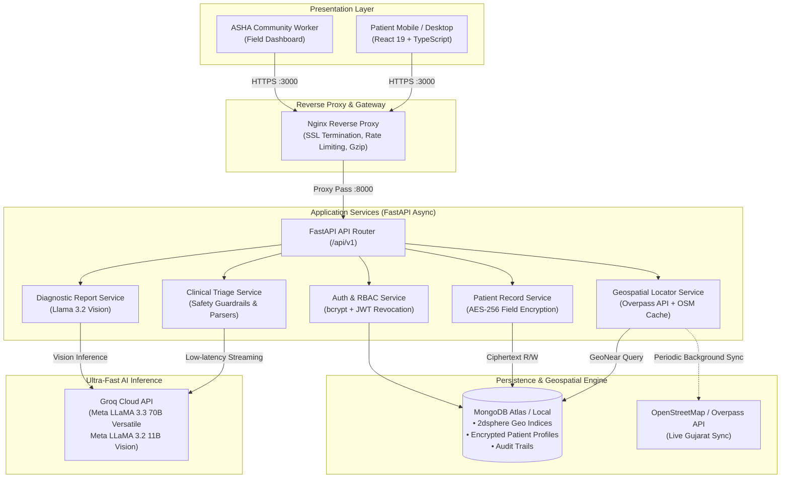

# HealthMitra 2.0 — Clinical AI Triage & Rural Healthcare Platform

<div align="center">

[](https://opensource.org/licenses/MIT)
[](https://fastapi.tiangolo.com)
[](https://react.dev)
[](https://groq.com)
[](https://groq.com)
[](https://www.mongodb.com)
[](docker-compose.yml)
[](#-healthcare-data-security--compliance)

**Empowering rural Indian healthcare with vernacular AI symptom triage, diagnostic report interpretation, geospatial facility discovery, and community frontline (ASHA) worker field orchestration.**

[Explore Live Demo](http://localhost:3000) • [API Documentation](http://localhost:8000/docs) • [Report a Vulnerability](https://github.com/Jaydeep0832/healthmitra/issues)

</div>

---

## 📑 Table of Contents

- [Problem Statement](#-problem-statement)
- [Proposed Solution](#-proposed-solution)
- [System Architecture](#-system-architecture)
- [AI & Clinical Engine](#-ai--clinical-decision-engine)
- [Core Features & Modules](#-core-features--modules)
- [ASHA Community Health Portal](#-asha-community-health-portal)
- [Technology Stack](#-technology-stack)
- [Healthcare Data Security & Privacy](#-healthcare-data-security--compliance)
- [Getting Started](#-getting-started)
- [API Reference](#-api-reference)
- [Testing & Quality Assurance](#-testing--quality-assurance)
- [Project Directory Layout](#-project-directory-layout)
- [Ethical AI & Clinical Disclaimer](#-ethical-ai--clinical-disclaimer)

---

## 🚨 Problem Statement

Over **65% of India's population** resides in rural and semi-urban regions, yet **nearly 75% of doctors and healthcare infrastructure are concentrated in urban metros**. This profound disparity leads to several critical healthcare delivery bottlenecks:

1. **Linguistic & Literacy Barriers**: Rural citizens often cannot describe symptoms or interpret complex diagnostic lab reports printed in medical English.
2. **Delayed Emergency & Triage Response**: Patients with acute conditions (myocardial infarction, acute sepsis, high-risk pre-eclampsia) fail to recognize early warning signs, delaying critical hospital transfers.
3. **Information Darkness in Facility Accessibility**: Locating nearby functional sub-centers, Community Health Centers (CHCs), oxygen-equipped facilities, or emergency pharmacies across remote districts remains fragmented and unreliable.
4. **Overburdened Frontline Healthcare Workers**: Accredited Social Health Activists (ASHA workers) manage hundreds of rural households using manual paper registers, leading to unmonitored high-risk pregnancies, missed immunization windows, and referral delays.

---

## 💡 Proposed Solution

**HealthMitra 2.0** bridges the urban-rural healthcare divide by uniting state-of-the-art Generative AI with localized public health infrastructure:

```
┌────────────────────────────────────────────────────────────────────────┐
│                        HEALTHMITRA 2.0 ECOSYSTEM                       │
└───────────────────────────────────┬────────────────────────────────────┘
                                    │
         ┌──────────────────────────┼──────────────────────────┐
         ▼                          ▼                          ▼
 🗣️ Vernacular AI Triage   🏥 Geospatial Discovery   👩‍⚕️ ASHA Field Portal
   • Hindi, Gujarati,         • 33 Gujarat Districts    • NHM Referral Slips
     Marathi, Bengali           OpenStreetMap Sync      • Antenatal Risk Flags
   • Emergency Red-Flags      • GeoJSON 2dsphere        • Offline-ready CSV
   • Vision Lab Parser          Proximity Search          Demographic Sync
```

- **Instant Multilingual Clinical Triage**: Conversational symptom assessment powered by Groq-accelerated Meta LLaMA 3.3 (70B) in 5 Indian languages (Hindi, Gujarati, Marathi, Bengali, English) with strict clinical safety guardrails.
- **Multimodal Diagnostic Lab Report Analysis**: Optical & vision parsing (LLaMA 3.2 Vision) that translates blood tests, lipid panels, and radiology impressions into plain, empathetic vernacular explanations.
- **Geospatial Healthcare Network**: Live Overpass OpenStreetMap synchronization indexing 1,000+ government hospitals, private clinics, and pharmacies across 33 districts of Gujarat with route calculations.
- **Dedicated ASHA Worker Community Suite**: Passcode-gated field dashboard (`ASHA2026`) enabling village demographic tracking, maternal antenatal vitals logging, urgent risk stratification, and auto-generated National Health Mission (NHM) referral slips.
- **Defense-in-Depth Healthcare Security**: Zero-leakage field-level AES-256 encryption for demographic and diagnostic records, token blacklisting, and immutable audit trails.

---

## 🏗️ System Architecture



---

## 🧠 AI & Clinical Decision Engine

HealthMitra 2.0 does not employ generic conversational chatbots. It utilizes a **two-tier clinical decision pipeline** engineered specifically for safety and medical accuracy:

### 1. Clinical Prompting & Triage Guardrails
```
+-------------------------------------------------------------------------+
| Patient Input (e.g., "મને છાતીમાં ખૂબ દુખાવો થાય છે અને ડાબો હાથ ભારે લાગે છે") |
+-------------------------------------------------------------------------+
                                     │
                                     ▼
        +────────────────────────────────────────────────────────+
        |  1. Emergency Red-Flag Interceptor (Zero-Latency)      |
        |  Matches: Chest pain, dyspnea, stroke signs, hemoptysis |
        +────────────────────────────────────────────────────────+
                     │                                 │
            [Critical Emergency]              [Non-Emergency Symptom]
                     │                                 │
                     ▼                                 ▼
   +───────────────────────────────────+  +───────────────────────────────────+
   | Immediate SOS Modal Triggered     |  | Clinical Reasoning Prompt           |
   | • 108 / 112 Speed-Dial Links      |  | • Differential Risk Categorization |
   | • Closest Cardiac ICU Filter      |  | • Vernacular Explanation (Gujarati) |
   | • First-Aid Action Checklist      |  | • Mandatory Physician Disclaimer  |
   +───────────────────────────────────+  +───────────────────────────────────+
```

### 2. Multimodal Diagnostic Vision Parser
Patients upload photographs of laboratory reports (CBC, Lipid Panel, Blood Glucose, Urine Routine). HealthMitra:
1. Performs vision OCR via **LLaMA 3.2 11B Vision**.
2. Normalizes numerical lab parameters against standard clinical reference ranges (e.g., HbA1c > 6.5%, Platelets < 150,000/µL).
3. Translates medical jargon into plain conversational vernacular terms (e.g., *"તમારું હિમોગ્લોબિન ઓછું છે, જે એનિમિયા (લોહીની કમી) દર્શાવે છે"*).

---

## 🌟 Core Features & Modules

### 1. 🤖 Vernacular AI Symptom Checker
- Multi-turn clinical reasoning supporting **English, Hindi, Gujarati, Marathi, and Bengali**.
- Auto-detects conversational tone, emotional stress, and localized medical colloquialisms.
- Formulates differential risk summaries with lifestyle, dietary, and physician follow-up advisories.

### 2. 🚨 Instant Emergency SOS System
- One-click trigger for national emergency services:
  - **108** — Emergency Ambulance Service
  - **102** — Pregnancy & Infant Transport
  - **112** — Integrated National Emergency
  - **104** — National Health Helpline
- Immediate nearby ICU and emergency trauma hospital filtering.

### 3. 🗺️ Geospatial Facility Locator
- High-performance Leaflet-based interactive mapping.
- **Haversine & MongoDB `2dsphere` queries** calculate real-time driving distances and travel times.
- Real-time filtering by facility type:
  - Government Civil Hospitals & Sub-Centers
  - Private Multi-Specialty Clinics
  - 24/7 Emergency Pharmacies & Jan Aushadhi Kendras

### 4. 👤 Patient Health Record Dashboard
- Complete timeline of clinical consultations and past symptom triage sessions.
- Secure vitals logging: Blood Pressure, Pulse, Blood Glucose, SpO2, BMI.
- Downloadable consultation summaries for physical hospital visits.

---

## 👩‍⚕️ ASHA Community Health Portal

HealthMitra 2.0 introduces an enterprise-grade frontline operations center designed specifically for Accredited Social Health Activists:

```
┌────────────────────────────────────────────────────────────────────────┐
│                      ASHA WORKER FIELD OPERATIONS                      │
├──────────────────┬──────────────────┬──────────────────┬───────────────┤
│ Active Roster    │ High-Risk Flags  │ Home Visits      │ NHM Referral  │
│ Village Families │ Antenatal Alert  │ Vitals Logging   │ Slip Printing │
└──────────────────┴──────────────────┴──────────────────┴───────────────┘
```

- **Authorized Passcode Verification**: Community workers enroll with designated Sub-Center codes (default sandbox: `ASHA2026`).
- **Village Cohort Tracking**: Active roster categorized by High-Risk, Antenatal Care (ANC), and Routine health states.
- **Home Visit Vitals Capture**: Log gestational age, blood pressure, hemoglobin, and fetal movements directly in the field.
- **NHM Referral Slip Generator**: Automatically generates formal referral slips with clinical history, provisional triage severity, and referring sub-center metadata for CHC/District Hospital admissions.
- **Offline CSV Export**: Instant roster export for district health administration reporting.

---

## 🛠️ Technology Stack

| Layer | Component | Version | Role & Justification |
| :--- | :--- | :--- | :--- |
| **Frontend** | React | `19.0.0` | Latest React engine with concurrent rendering |
| | TypeScript | `5.7.0` | Strict type safety across clinical data models |
| | TailwindCSS | `3.4.0` | Modern, responsive healthcare UI design system |
| | Zustand | `5.0.0` | Lightweight, un-opinionated reactive global state |
| | React-Leaflet | `5.0.0` | Hardware-accelerated map visualization & GPS markers |
| | Lucide React | `0.475.0`| Accessible, high-clarity clinical iconography |
| **Backend** | FastAPI | `0.115.0` | High-throughput asynchronous Python ASGI framework |
| | Pydantic | `2.10.0` | Runtime validation for strict clinical payloads |
| | Motor | `3.6.0` | Asynchronous MongoDB driver for zero-blocking I/O |
| | PyCryptodome | `3.21.0` | AES-256-GCM cipher for field-level encryption |
| | PyJWT | `2.10.0` | Stateless cryptographic access & refresh authorization |
| | Passlib / bcrypt | `1.7.4` | Industry-standard password key derivation (cost factor 12) |
| **AI Inference**| Groq Cloud | LLaMA 3.3 70B | Sub-second generative inference for clinical triage |
| | Groq Vision | LLaMA 3.2 11B | High-resolution medical report optical extraction |
| **Database** | MongoDB | `7.0` | Document datastore with native `2dsphere` geospatial indexing |
| **DevOps** | Docker Compose | `v2` | Multi-container orchestration (Nginx, API, Mongo) |
| | Nginx | `1.25 Alpine`| Production reverse proxy, TLS termination, and compression |

---

## 🛡️ Healthcare Data Security & Compliance

HealthMitra 2.0 adopts the **Principle of Least Privilege** and architectural patterns aligned with **DISHA (Digital Information Security in Healthcare Act)** and **HIPAA Security Rule** guidelines:

```
[Incoming Payload] ──► [FastAPI Router]
                              │
                    [Security Middleware]
                    • JWT Signature Verify
                    • Revocation Blacklist Check
                    • Role Authorization (RBAC)
                              │
                    [Patient Service Layer]
                              │
               ┌──────────────┴──────────────┐
               ▼                             ▼
      [Cleartext Metadata]          [Sensitive Health Data]
      • user_id                     • medical_history
      • created_at                  • triage_symptoms
      • role                        • diagnostic_reports
               │                             │
               │                   [Field-Level Encryption]
               │                   AES-256-GCM (Fernet Cipher)
               │                             │
               ▼                             ▼
        [MongoDB Document Storage (Restricted Ciphertext)]
```

- **Field-Level Data Encryption**: Sensitive clinical observations, diagnoses, and personal health identifiers (PHI) are encrypted with AES-256 before being committed to MongoDB.
- **Granular RBAC**: Role separation enforced across `patient`, `asha_worker`, and `admin` scopes.
- **Stateful JWT Revocation**: Real-time token revocation on logout to prevent replay attacks.
- **Encrypted Key Rotation**: Built-in cryptographic migration utility (`backend/scripts/rotate_encryption_key.py`) allowing seamless key rotation without downtime.
- **Zero Raw PII in Logs**: Clinical prompts and chat histories are scrubbed before persistence into audit logs.

---

## 🚀 Getting Started

### Prerequisites

Ensure the following tools are installed on your workstation:
- **Docker Desktop** (v24.0+) & **Docker Compose** (v2.20+)
- **Node.js** (v20+ LTS) *(optional, for local bare-metal frontend dev)*
- **Python** (v3.11+) *(optional, for local bare-metal backend dev)*
- A free **Groq Cloud API Key** from [console.groq.com](https://console.groq.com)

---

### Option A: Complete Docker Compose Stack (Recommended)

1. **Clone the repository**:
   ```bash
   git clone https://github.com/Jaydeep0832/healthmitra.git
   cd healthmitra
   ```

2. **Configure Environment Variables**:
   ```bash
   cp backend/.env.example backend/.env
   ```
   Open `backend/.env` and provide your secrets:
   ```env
   GROQ_API_KEY=gsk_your_actual_groq_api_key_here
   SECRET_KEY=generate_with_python_secrets_token_urlsafe_48
   ENCRYPTION_KEY=generate_with_fernet_generate_key
   MONGODB_URI=mongodb://mongo:27017
   DATABASE_NAME=healthmitra
   ```

3. **Launch the Containers**:
   ```bash
   docker compose up -d --build
   ```

4. **Verify Deployment**:
   - **Frontend Application**: [http://localhost:3000](http://localhost:3000)
   - **Backend API & Swagger Docs**: [http://localhost:8000/docs](http://localhost:8000/docs)
   - **Database**: `localhost:27017`

5. **(Optional) Seed Live Gujarat Medical Facilities**:
   ```bash
   docker compose exec backend python -m scripts.sync_gujarat
   ```

---

### Option B: Local Bare-Metal Development

#### 1. Backend Setup
```bash
cd backend
python -m venv venv

# Windows PowerShell:
.\venv\Scripts\Activate.ps1
# Linux / macOS:
source venv/bin/activate

pip install -r requirements.txt
cp .env.example .env
uvicorn app.main:app --host 0.0.0.0 --port 8000 --reload
```

#### 2. Frontend Setup
```bash
cd frontend
npm install
npm run dev
# Vite will launch on http://localhost:3000 (or http://localhost:5173)
```

---

## 🔌 API Reference

Explore the interactive OpenAPI documentation at `http://localhost:8000/docs`. Key operational endpoints:

### 🔐 Authentication & Session
| Method | Endpoint | Authorization | Description |
| :--- | :--- | :--- | :--- |
| `POST` | `/api/v1/auth/register` | Public | Register a Patient or ASHA Worker (`passcode` required for ASHA) |
| `POST` | `/api/v1/auth/login` | Public | Authenticate credentials and receive Bearer JWT |
| `POST` | `/api/v1/auth/logout` | Bearer Token | Invalidate current session token on server blacklist |
| `GET` | `/api/v1/auth/me` | Bearer Token | Retrieve profile metadata of authenticated identity |

### 🤖 Clinical AI & Diagnostic Services
| Method | Endpoint | Authorization | Description |
| :--- | :--- | :--- | :--- |
| `POST` | `/api/v1/triage/check` | Authenticated | Clinical symptom assessment and emergency risk score |
| `POST` | `/api/v1/chatbot/message` | Authenticated | Multi-turn vernacular conversational consultation |
| `GET` | `/api/v1/chatbot/history` | Authenticated | Retrieve encrypted chat transcript |
| `POST` | `/api/v1/reports/upload` | Authenticated | Multimodal diagnostic image upload & clinical extraction |
| `POST` | `/api/v1/reports/analyze-text`| Authenticated | Raw clinical text / lab summary analysis |

### 🏥 Geospatial Facilities & Mapping
| Method | Endpoint | Authorization | Description |
| :--- | :--- | :--- | :--- |
| `GET` | `/api/v1/hospitals/nearby` | Public | Proximity query (`lat`, `lng`, `radius_km`, `facility_type`) |
| `GET` | `/api/v1/hospitals/search` | Public | Keyword and specialty healthcare search |
| `GET` | `/api/v1/hospitals/{id}` | Public | Detailed facility attributes, contact, and bed stats |
| `POST` | `/api/v1/hospitals/sync-gujarat`| Admin | Trigger live Overpass OSM background facility sync |

### 📋 Patient & Field Operations
| Method | Endpoint | Authorization | Description |
| :--- | :--- | :--- | :--- |
| `GET` | `/api/v1/patients/me` | Patient / ASHA | Retrieve encrypted demographic card |
| `PUT` | `/api/v1/patients/me` | Patient / ASHA | Update vitals and demographic data |
| `GET` | `/api/v1/patients/me/dashboard`| Patient | Retrieve health score, history, and alerts |

---

## 🧪 Testing & Quality Assurance

HealthMitra maintains high test standards covering security primitives, API routes, and frontend components:

### Run Backend Unit & Integration Tests
```bash
cd backend
pytest -v --disable-warnings
```

Test suite highlights:
- **Field-Level Encryption**: Verifies ciphertext integrity, deterministic decryption, and tamper resistance (`test_security.py`).
- **Authentication Flows**: Validates password hashing, expired token rejection, and role-gated access.
- **Triage Sanitization**: Ensures clinical prompts trigger appropriate emergency classifications.

### Run Frontend Component & API Tests
```bash
cd frontend
npm run test
```

---

## 📁 Project Directory Layout

```
healthmitra/
├── backend/
│   ├── app/
│   │   ├── api/v1/               # Clean REST routers (auth, triage, hospitals, reports)
│   │   ├── db/                   # MongoDB motor connection and geospatial init
│   │   ├── models/               # Pydantic schemas (User, Hospital, Triage, Report)
│   │   ├── security/             # AES-256 field encryption, JWT handlers, RBAC
│   │   ├── services/             # LLM orchestration, OSM syncing, patient records
│   │   ├── config.py             # Typed application settings (Pydantic BaseSettings)
│   │   └── main.py               # FastAPI ASGI entrypoint & middleware setup
│   ├── scripts/                  # Encryption rotation and Gujarat OSM sync scripts
│   ├── tests/                    # Pytest test suites (security, auth, triage)
│   ├── Dockerfile                # Lightweight Python 3.11 production container
│   └── requirements.txt          # Frozen backend dependencies
├── frontend/
│   ├── src/
│   │   ├── components/
│   │   │   ├── Common/           # EmergencyModal, ErrorBoundary, Glassmorphic Cards
│   │   │   ├── Dashboard/        # ProfileCard, AshaCommunityPortal, VitalsTrack
│   │   │   ├── HospitalLocator/  # Map, HospitalList, FilterPanel, GPS Locator
│   │   │   └── Layout/           # Responsive Navbar, Footers, LangSwitcher
│   │   ├── pages/                # Home, Dashboard, Hospitals, Symptoms, Reports, Auth
│   │   ├── services/             # Typed Axios HTTP client with auto-refresh tokens
│   │   ├── store/                # Zustand stores (useAuthStore, useLocationStore)
│   │   ├── types/                # Strict TypeScript clinical interfaces
│   │   ├── App.tsx               # Client router & authentication guards
│   │   └── index.css             # Healthcare design system tokens & animations
│   ├── Dockerfile                # Multi-stage optimized Nginx frontend image
│   └── package.json              # React 19 dependencies & scripts
├── docker-compose.yml            # Multi-service local composition
├── docker-compose.prod.yml       # Production composition with TLS & restart policies
├── nginx.conf                    # Nginx gateway reverse proxy rules
└── README.md                     # Comprehensive technical documentation
```

---

## ⚖️ Ethical AI & Clinical Disclaimer

> **IMPORTANT MEDICAL NOTICE**:  
> HealthMitra 2.0 is an artificial intelligence-assisted clinical decision-support and navigation platform designed to augment healthcare access in underserved regions. **HealthMitra does not replace a licensed medical doctor, certified physician, or hospital emergency room.**  
> - In any life-threatening situation (chest tightness, severe trauma, stroke symptoms, acute shortness of breath), immediately dial **108** or proceed to the nearest emergency room.  
> - Diagnostic report interpretations provided by HealthMitra are intended for educational and preliminary informational purposes only. Always present formal laboratory printouts to a licensed physician before initiating or modifying any medical treatment.

---

## 📜 License

This project is licensed under the **MIT License** — see the [LICENSE](LICENSE) file for complete details.

---

<div align="center">
  <sub>Built with ❤️ for Indian Healthcare Equity • HealthMitra 2.0</sub>
</div>
