# HealthMitra 2.0 — Clinical AI Triage & Rural Healthcare Platform

<div align="center">

[](https://opensource.org/licenses/MIT)
[](https://fastapi.tiangolo.com)
[](https://react.dev)
[](https://groq.com)
[](https://groq.com)
[](https://www.mongodb.com)
[](docker-compose.yml)
[](#-healthcare-data-security--compliance)

**Empowering rural Indian healthcare with vernacular AI symptom triage, diagnostic report interpretation, geospatial facility discovery, and community frontline (ASHA) worker field orchestration.**

[🌐 Live Web Platform](https://healthmitra-dsgg.onrender.com) • [🏥 Healthcare Locator](https://healthmitra-dsgg.onrender.com/hospitals) • [💬 AI Assistant](https://healthmitra-dsgg.onrender.com/chatbot) • [🔐 Sign In](https://healthmitra-dsgg.onrender.com/login) • [API Health](https://healthmitra-backend-mu58.onrender.com/api/health) • [Report Issue](https://github.com/Jaydeep0832/healthmitra/issues)

</div>

<div align="center">

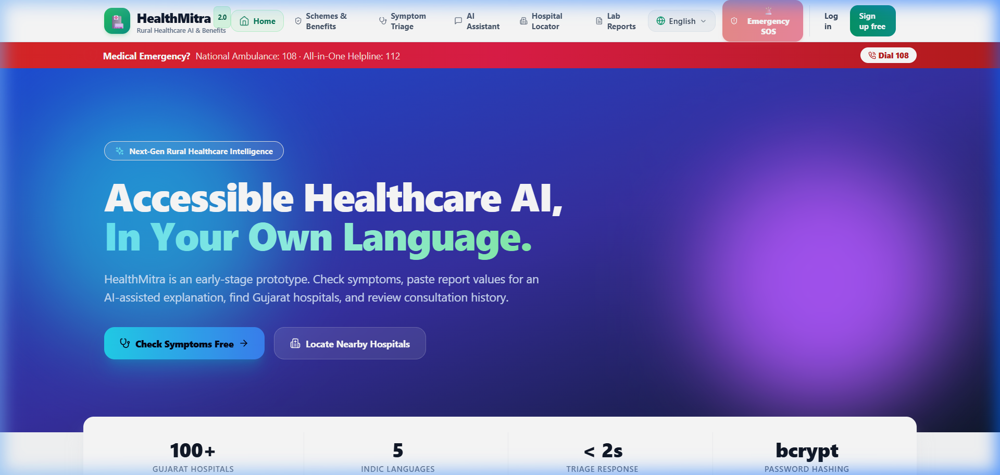

</div>

---

## 📑 Table of Contents

- [Problem Statement](#-problem-statement)
- [Proposed Solution](#-proposed-solution)
- [Platform Facilities & Visual Showcase](#-platform-facilities--visual-showcase)
- [System Architecture](#-system-architecture)
- [AI & Clinical Decision Engine](#-ai--clinical-decision-engine)
- [Core Features & Modules](#-core-features--modules)
- [ASHA Community Health Portal](#-asha-community-health-portal)
- [Technology Stack](#-technology-stack)
- [Healthcare Data Security & Privacy](#-healthcare-data-security--compliance)
- [Getting Started](#-getting-started)
- [API Reference](#-api-reference)
- [Testing & Quality Assurance](#-testing--quality-assurance)
- [Ethical AI & Clinical Disclaimer](#-ethical-ai--clinical-disclaimer)

---

## 🚨 Problem Statement

Over **65% of India's population** resides in rural and semi-urban regions, yet **nearly 75% of doctors and healthcare infrastructure are concentrated in urban metros**. This profound disparity leads to several critical healthcare delivery bottlenecks:

1. **Linguistic & Literacy Barriers**: Rural citizens often cannot describe symptoms or interpret complex diagnostic lab reports printed in medical English.
2. **Delayed Emergency & Triage Response**: Patients with acute conditions (myocardial infarction, acute sepsis, high-risk pre-eclampsia) fail to recognize early warning signs, delaying critical hospital transfers.
3. **Information Darkness in Facility Accessibility**: Locating nearby functional sub-centers, Community Health Centers (CHCs), oxygen-equipped facilities, or emergency pharmacies across remote districts remains fragmented and unreliable.
4. **Overburdened Frontline Healthcare Workers**: Accredited Social Health Activists (ASHA workers) manage hundreds of rural households using manual paper registers, leading to unmonitored high-risk pregnancies, missed immunization windows, and referral delays.

---

## 💡 Proposed Solution

**HealthMitra 2.0** bridges the urban-rural healthcare divide by uniting state-of-the-art Generative AI with localized public health infrastructure:

```
┌────────────────────────────────────────────────────────────────────────┐
│                        HEALTHMITRA 2.0 ECOSYSTEM                       │
└───────────────────────────────────┬────────────────────────────────────┘
                                    │
         ┌──────────────────────────┼──────────────────────────┐
         ▼                          ▼                          ▼
 🗣️ Vernacular AI Triage   🏥 Geospatial Discovery   👩‍⚕️ ASHA Field Portal
   • Hindi, Gujarati,         • 33 Gujarat Districts    • NHM Referral Slips
     Marathi, Bengali           OpenStreetMap Sync      • Antenatal Risk Flags
   • Emergency Red-Flags      • GeoJSON 2dsphere        • Offline-ready CSV
   • Vision Lab Parser          Proximity Search          Demographic Sync
```

- **Instant Multilingual Clinical Triage**: Conversational symptom assessment powered by Groq-accelerated Meta LLaMA 3.3 (70B) in 5 Indian languages (Hindi, Gujarati, Marathi, Bengali, English) with strict clinical safety guardrails.
- **Multimodal Diagnostic Lab Report Analysis**: Optical & vision parsing (LLaMA 3.2 Vision) that translates blood tests, lipid panels, and radiology impressions into plain, empathetic vernacular explanations.
- **Geospatial Healthcare Network**: Live Overpass OpenStreetMap synchronization indexing 1,000+ government hospitals, private clinics, and pharmacies across 33 districts of Gujarat with route calculations.
- **Dedicated ASHA Worker Community Suite**: Passcode-gated field dashboard (`ASHA2026`) enabling village demographic tracking, maternal antenatal vitals logging, urgent risk stratification, and auto-generated National Health Mission (NHM) referral slips.
- **Defense-in-Depth Healthcare Security**: Zero-leakage field-level AES-256 encryption for demographic and diagnostic records, token blacklisting, and immutable audit trails.

---

## 📸 Platform Facilities & Visual Showcase

HealthMitra 2.0 provides an end-to-end digital health infrastructure designed for citizens, patients, and frontline community health workers across India. Explore the live platform interfaces and key facilities below:

### 1. 👩‍⚕️ ASHA Community Health Worker Field Portal
> **Frontline healthcare operational dashboard** allowing ASHA workers to manage rural cohorts, track antenatal care (ANC) vitals, flag high-risk pregnancies, and generate official National Health Mission (NHM) referral slips.

<p align="center">
  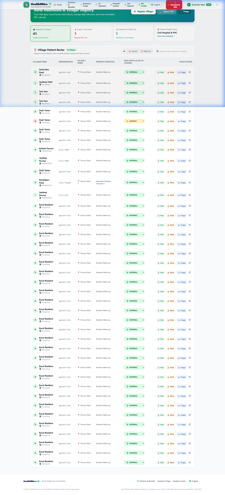
</p>

---

### 2. 🗺️ Geospatial Medical Facilities & Healthcare Locator
> **Interactive geospatial discovery engine** indexing 169+ verified health facilities (Civil Hospitals, private multispeciality centers, primary health clinics, and 24/7 Jan Aushadhi pharmacies) across all 33 districts of Gujarat. Filter by distance radius (5km to 500km), bed counts, ICU availability, ambulance fleet, and view complete facility specifications with turn-by-turn GPS directions.

<p align="center">
  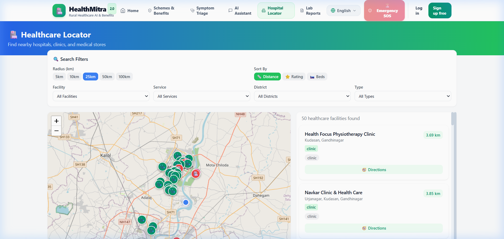
</p>

---

### 3. 🤖 Vernacular AI Symptom Triage & Red-Flag Checker
> **Sub-second clinical triage powered by Groq & LLaMA 3.3 (70B)** supporting English, Hindi, Gujarati, Marathi, and Bengali. Analyzes symptoms, computes urgency levels, and detects life-threatening conditions immediately.

<p align="center">
  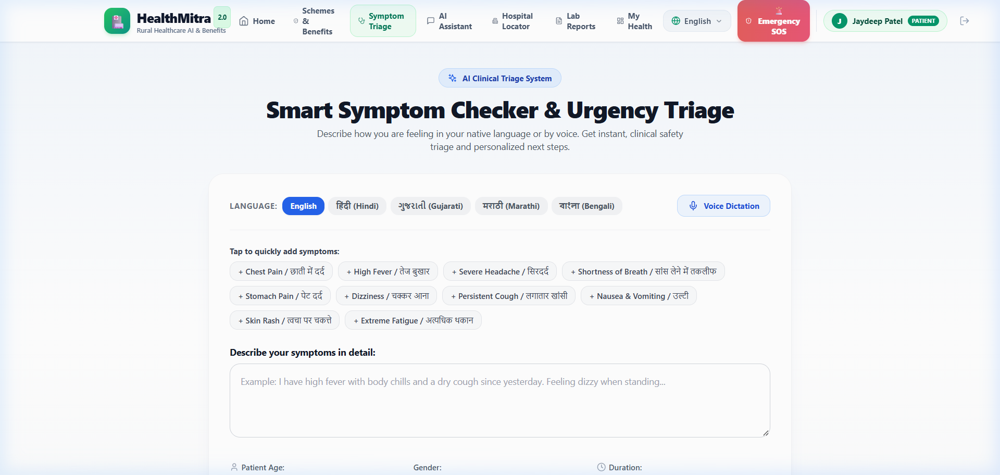
</p>

---

### 4. 🏛️ Government Health Schemes & Patient Benefits Directory
> **Comprehensive benefits finder** helping middle-class and rural families discover central & state healthcare schemes (Ayushman Bharat PM-JAY, MA Yojana, Critical Illness Funds) with eligibility calculators, claims tracking, and direct application links.

<p align="center">
  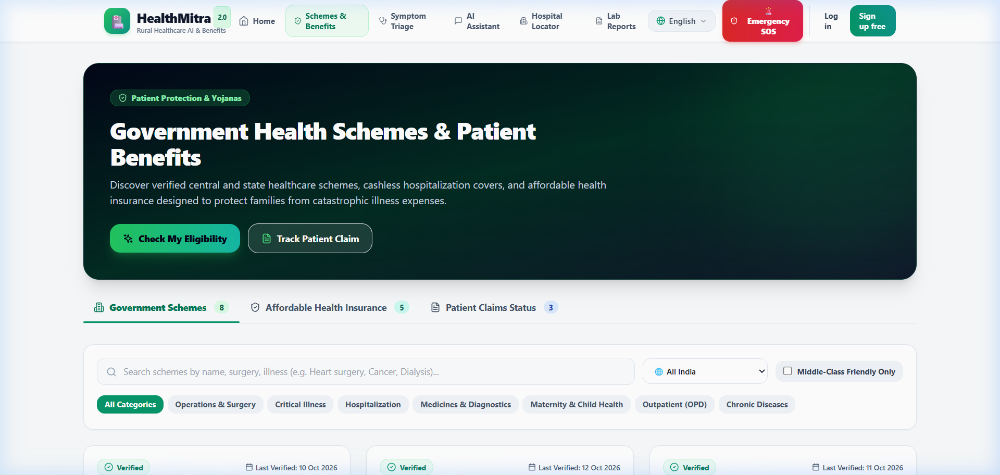
</p>

---

### 5. 🧪 Multimodal Diagnostic Lab Report Interpreter
> **Vision AI diagnostic engine (LLaMA 3.2 Vision)** that parses blood tests, lipid panels, and pathology reports, normalizes lab values against clinical reference standards, and explains results in simple vernacular language.

<p align="center">
  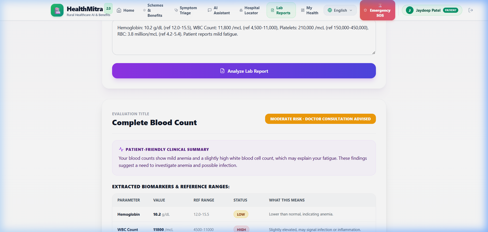
</p>

---

### 6. 👤 Patient Health Record & Wellness Dashboard
> **Personalized longitudinal health portal** featuring vital signs tracking (BP, pulse, glucose, SpO2), health risk scores, upcoming checkups, and encrypted medical consultation history.

<p align="center">
  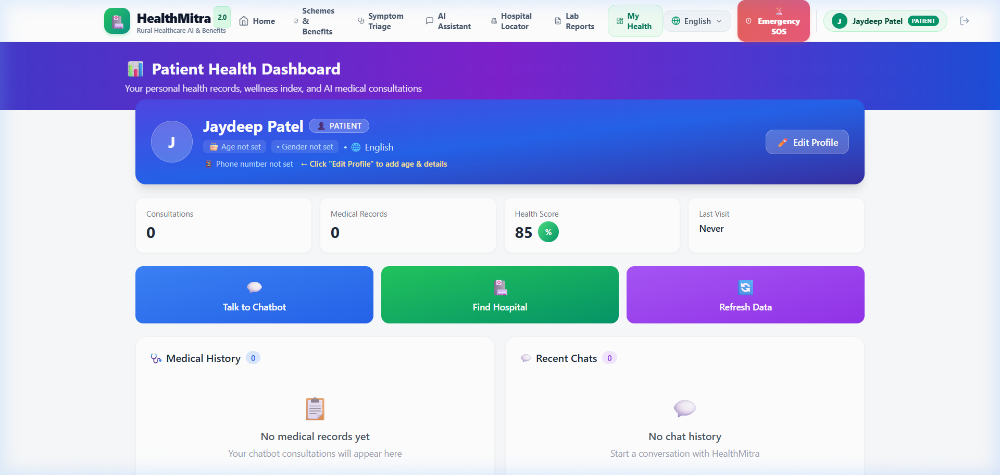
</p>

---

### 7. 🚨 Instant Emergency SOS Response Modal
> **One-touch critical dispatch modal** with emergency dialers (108 Ambulance, 102 Maternal, 112 National Emergency, 104 Helpline), live GPS broadcast, and nearest emergency hospital routing.

<p align="center">
  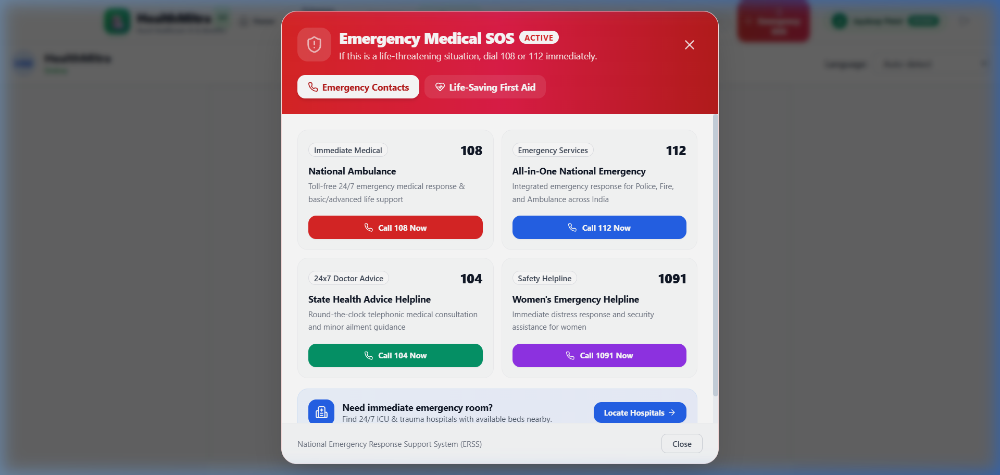
</p>

---

### 8. 💬 24/7 Vernacular Clinical AI Assistant
> **Full-viewport conversational clinical agent** delivering evidence-based triage, health scheme guidance (such as Ayushman Bharat PM-JAY and MA Yojana application workflows), symptom analysis, and preventative counseling in 5 Indian languages (Gujarati, Hindi, Marathi, Bengali, and English) with structured action cards and emergency 108 integration.

<p align="center">
  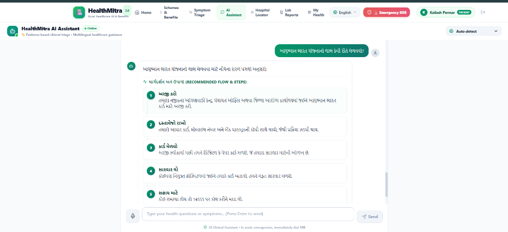
</p>

---

### 9. 🔐 Dual-Role Authentication & Onboarding (Login & Signup)
> **256-bit encrypted healthcare sessions** supporting dual roles for rural citizens/patients and accredited ASHA community health workers. Features passcode-protected field worker credentials, automated token rotation, quick-dial healthcare helplines, and localized access.

| 🔑 Secure Patient & Worker Login | 📝 Dual-Role Registration & Role Assignment |
| :---: | :---: |
| 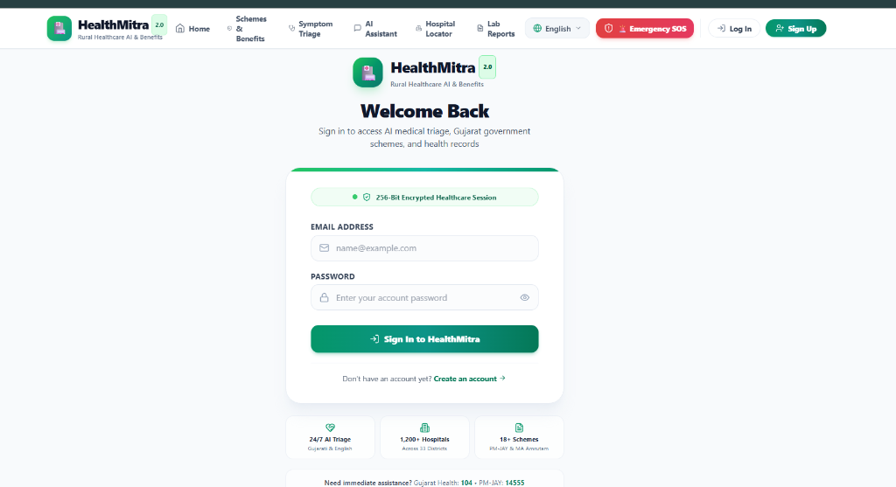 | 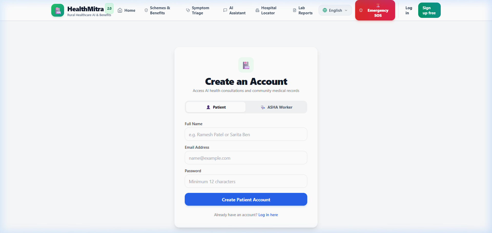 |

---

## 🏗️ System Architecture

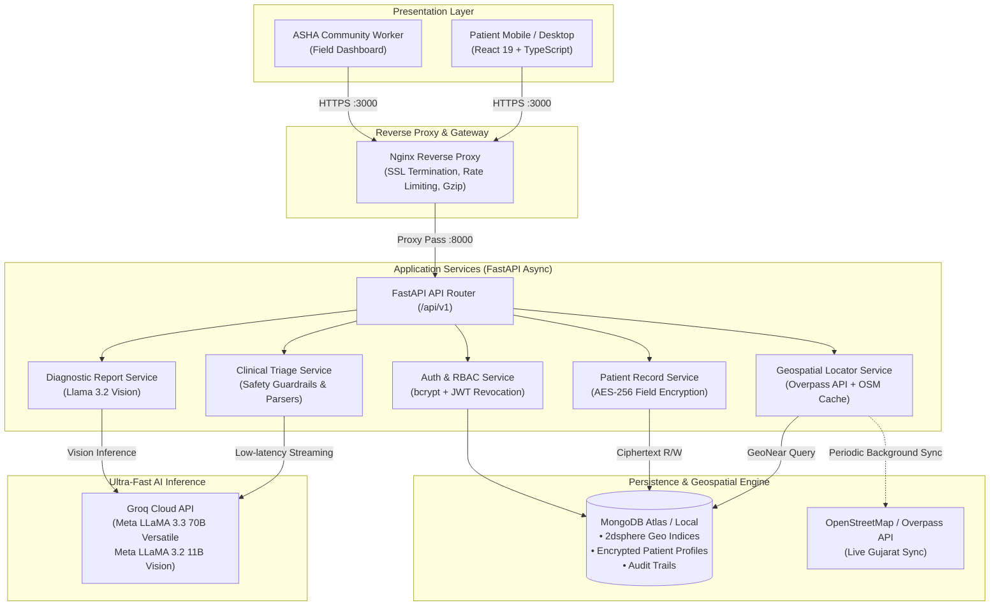

---

## 🧠 AI & Clinical Decision Engine

HealthMitra 2.0 does not employ generic conversational chatbots. It utilizes a **two-tier clinical decision pipeline** engineered specifically for safety and medical accuracy:

### 1. Clinical Prompting & Triage Guardrails
```
+-------------------------------------------------------------------------+
| Patient Input (e.g., "મને છાતીમાં ખૂબ દુખાવો થાય છે અને ડાબો હાથ ભારે લાગે છે") |
+-------------------------------------------------------------------------+
                                     │
                                     ▼
        +────────────────────────────────────────────────────────+
        |  1. Emergency Red-Flag Interceptor (Zero-Latency)      |
        |  Matches: Chest pain, dyspnea, stroke signs, hemoptysis |
        +────────────────────────────────────────────────────────+
                     │                                 │
            [Critical Emergency]              [Non-Emergency Symptom]
                     │                                 │
                     ▼                                 ▼
   +───────────────────────────────────+  +───────────────────────────────────+
   | Immediate SOS Modal Triggered     |  | Clinical Reasoning Prompt           |
   | • 108 / 112 Speed-Dial Links      |  | • Differential Risk Categorization |
   | • Closest Cardiac ICU Filter      |  | • Vernacular Explanation (Gujarati) |
   | • First-Aid Action Checklist      |  | • Mandatory Physician Disclaimer  |
   +───────────────────────────────────+  +───────────────────────────────────+
```

### 2. Multimodal Diagnostic Vision Parser
Patients upload photographs of laboratory reports (CBC, Lipid Panel, Blood Glucose, Urine Routine). HealthMitra:
1. Performs vision OCR via **LLaMA 3.2 11B Vision**.
2. Normalizes numerical lab parameters against standard clinical reference ranges (e.g., HbA1c > 6.5%, Platelets < 150,000/µL).
3. Translates medical jargon into plain conversational vernacular terms (e.g., *"તમારું હિમોગ્લોબિન ઓછું છે, જે એનિમિયા (લોહીની કમી) દર્શાવે છે"*).

---

## 🌟 Core Features & Modules

### 1. 🤖 Vernacular AI Symptom Checker
- Multi-turn clinical reasoning supporting **English, Hindi, Gujarati, Marathi, and Bengali**.
- Auto-detects conversational tone, emotional stress, and localized medical colloquialisms.
- Formulates differential risk summaries with lifestyle, dietary, and physician follow-up advisories.

#### 📋 4-Tier Clinical Risk Stratification Protocol
| Urgency Tier | Clinical Indicator Examples | Target Response Window | Automated Clinical Action |
| :--- | :--- | :--- | :--- |
| 🔴 **EMERGENCY** | Acute crushing chest pain, dyspnea, stroke signs (F.A.S.T.), severe trauma | **Immediate (< 15 mins)** | Triggers Speed-Dial SOS (108/112) & nearest cardiac ICU route |
| 🟠 **URGENT** | High persistent fever (>103°F), unremitting acute abdominal pain, dehydration | **Within 12–24 hours** | Recommends nearby CHC / Civil Hospital outpatient department |
| 🟡 **ROUTINE** | Mild seasonal rhinitis, chronic joint aches, localized dermatitis | **Scheduled Consultation** | Formulates clinical question checklist for physical physician visit |
| 🟢 **SELF_CARE** | Mild tension headache, transient fatigue, minor muscle stiffness | **Home Monitoring** | Evidence-based hydration, rest, and home monitoring advice |

---

### 2. 🚨 Instant Emergency SOS System
- One-click trigger for national emergency services:
  - **108** — Emergency Ambulance Service (EMRI)
  - **102** — Free Janani Shishu Suraksha Karyakram (Pregnancy / Neonatal transport)
  - **112** — Integrated National Unified Emergency
  - **104** — 24/7 State Medical Advice & Health Information Helpline
  - **1091** — Women's Safety & Distress Helpline
- Immediate nearby ICU, oxygen bed, and emergency trauma hospital filtering.

#### 🫀 Life-Saving Emergency First-Aid Protocols
| Condition | Immediate Clinical Action | Key Medical Guideline |
| :--- | :--- | :--- |
| **Cardiac Arrest** | Adult CPR (Cardiopulmonary Resuscitation) | 30 chest compressions : 2 rescue breaths at 100–120 bpm, 5–6 cm depth |
| **Suspected Heart Attack** | Semi-recumbent "W-position" | Keep patient seated with knees bent, loosen collar/waist, chew Aspirin 300mg if advised |
| **Severe Hemorrhage** | Direct wound pressure & elevation | Sterile gauze pressure, elevate limb above heart, prepare arterial tourniquet if spurting |
| **Stroke (Brain Attack)** | F.A.S.T. Assessment | **F**ace drooping, **A**rm weakness, **S**peech slurred, **T**ime to dial 108 immediately |

---

### 3. 🗺️ Geospatial Facility Locator
- High-performance Leaflet-based interactive mapping with zero Google Maps API licensing overhead.
- **Haversine & MongoDB `2dsphere` queries** calculate real-time driving distances and travel times in < 100ms.
- Real-time filtering across 1,000+ verified Gujarat healthcare facilities:
  - Government Civil Hospitals & Community Health Centers (CHCs)
  - Private Multi-Specialty Clinics & Diagnostic Labs
  - 24/7 Emergency Pharmacies & Pradhan Mantri Jan Aushadhi Kendras

#### 📍 Geospatial Indexing & Overpass OSM Ingestion Engine
```
┌────────────────────────────────────────────────────────┐
│     Client Location (navigator.geolocation / GPS)     │
└───────────────────────────┬────────────────────────────┘
                            ▼
      MongoDB 2dsphere Spatial Query ($near / $maxDistance)
                            │
              ┌─────────────┴─────────────┐
              ▼                           ▼
    Tier 1: Seed Dataset        Tier 2: Real-Time OpenStreetMap
    (102+ Tertiary Hospitals)   (Background Overpass QL Ingestion)
```

---

### 4. 👤 Patient Health Record Dashboard
- Complete timeline of clinical consultations and past symptom triage sessions.
- Secure vitals logging: Blood Pressure, Pulse, Blood Glucose, SpO2, and BMI.
- Downloadable consultation summaries formatted for physical hospital visits.

#### 🔐 Zero-Knowledge Field-Level Encryption Model
Sensitive Personal Health Information (PHI) is encrypted with **Fernet (AES-128-CBC + HMAC-SHA256)** before persistence to disk:
```json
{
  "user_id": "670aa3f14f91c9001b9a1204",
  "health_score": 88,
  "vitals": {
    "blood_pressure": "gAAAAABnC7kL2m1p0Qe...",
    "pulse": "gAAAAABnC7kLbT4...==",
    "blood_glucose": "gAAAAABnC7kLo9X..."
  }
}
```
*Ciphertext starting with `gAAAAA...` guarantees that neither database administrators nor unauthorized actors can access patient vitals in plaintext.*

---

### 5. 🏛️ Government Health Schemes & Benefits Directory
- Direct discovery of Indian healthcare safety nets: **Ayushman Bharat PM-JAY**, **Mukhyamantri Amrutam (MA)**, **Janani Suraksha Yojana (JSY)**, **Rashtriya Arogya Nidhi (RAN)**, and PM National Relief Fund.
- Smart eligibility checker (BPL card status, annual income thresholds, and specific disease categorization).
- Complete procedure coverage details, required document checklists, and verified application portals.

#### 🇮🇳 Key Government Healthcare Schemes Matrix
| Scheme Name | Issuing Authority | Financial Coverage | Target Demographic & Eligibility |
| :--- | :--- | :--- | :--- |
| **Ayushman Bharat (PM-JAY)** | National Health Authority | **₹5 Lakh / family / year** | Bottom 40% vulnerable families (SECC 2011 criteria) |
| **Mukhyamantri Amrutam (MA)** | Govt of Gujarat | **₹5 Lakh / family / year** | BPL and lower-middle-class families (income ≤ ₹4 Lakh) |
| **Janani Suraksha Yojana (JSY)** | Ministry of Health & Family Welfare | **₹1,400 – ₹1,000 cash aid** | Institutional delivery for rural pregnant women |
| **Rashtriya Arogya Nidhi (RAN)** | Central Govt Health Ministry | **Up to ₹15 Lakh assistance** | BPL patients suffering from life-threatening critical illnesses |

---

### 6. 🧪 Multimodal Diagnostic Lab Report Interpreter
- Optical parsing and diagnostic inference via **LLaMA 3.2 11B Vision**.
- Automatic out-of-range biomarker flagging (e.g., HbA1c, fasting glucose, platelets, hemoglobin).
- Plain vernacular patient summaries and clinical questions for the next physician visit.

#### 🔬 Clinical Biomarker Reference Standards
| Clinical Biomarker | Physiological Reference Range | Low Tag (🟡) Indication | High Tag (🔴) Indication |
| :--- | :--- | :--- | :--- |
| **Hemoglobin (Hb)** | 13.0 – 17.0 g/dL (M) / 12.0 – 15.5 g/dL (F) | Nutritional Anemia, Blood Loss | Polycythemia, Chronic Hypoxia |
| **Platelet Count** | 150,000 – 450,000 / µL | Dengue, Thrombocytopenia risk | Essential Thrombocythemia |
| **Fasting Blood Glucose**| 70 – 100 mg/dL | Hypoglycemic shock risk | Impaired Fasting Glucose, Diabetes |
| **HbA1c (Glycated Hb)** | 4.0% – 5.6% | Rare hypoglycemia | 5.7–6.4% Prediabetes, ≥6.5% Diabetes |
| **Serum Creatinine** | 0.7 – 1.3 mg/dL | Muscle wasting | Renal impairment, Acute Kidney Injury |
| **Total Cholesterol** | < 200 mg/dL | Malnutrition / Liver failure | Atherosclerosis, Cardiovascular risk |

---

## 👩‍⚕️ ASHA Community Health Portal

HealthMitra 2.0 introduces an enterprise-grade frontline operations center designed specifically for Accredited Social Health Activists:

```
┌────────────────────────────────────────────────────────────────────────┐
│                      ASHA WORKER FIELD OPERATIONS                      │
├──────────────────┬──────────────────┬──────────────────┬───────────────┤
│ Active Roster    │ High-Risk Flags  │ Home Visits      │ NHM Referral  │
│ Village Families │ Antenatal Alert  │ Vitals Logging   │ Slip Printing │
└──────────────────┴──────────────────┴──────────────────┴───────────────┘
```

- **Authorized Passcode Verification**: Community workers enroll with designated Sub-Center codes (default sandbox: `ASHA2026`).
- **Village Cohort Tracking**: Active roster categorized by High-Risk, Antenatal Care (ANC), and Routine health states.
- **Home Visit Vitals Capture**: Log gestational age, blood pressure, hemoglobin, and fetal movements directly in the field.
- **NHM Referral Slip Generator**: Automatically generates formal referral slips with clinical history, provisional triage severity, and referring sub-center metadata for CHC/District Hospital admissions.
- **Offline CSV Export**: Instant roster export for district health administration reporting.

#### 📑 Frontline Antenatal Care (ANC) & Referral Standards
| Trimester & Window | Routine Field Vitals Checked | High-Risk Red Flags (Immediate Referral) |
| :--- | :--- | :--- |
| **1st ANC (≤ 12 Weeks)** | Confirmation, Hemoglobin, Blood Group, Weight | Severe hyperemesis, previous ectopic pregnancy, Hb < 7 g/dL |
| **2nd ANC (14–26 Weeks)** | Blood Pressure, Fundal height, Fetal Heart Sound | BP ≥ 140/90 mmHg (Preeclampsia risk), gestational diabetes |
| **3rd ANC (28–36 Weeks)** | Fetal movement count, presentation, edema | Premature rupture of membranes, visual disturbances, epigastric pain |
| **Referral Destination** | Primary Health Center (PHC) / Sub-Center | Community Health Center (CHC) or District Civil Hospital |

---

## 🛠️ Technology Stack

| Layer | Component | Version | Role & Justification |
| :--- | :--- | :--- | :--- |
| **Frontend** | React | `19.0.0` | Latest React engine with concurrent rendering |
| | TypeScript | `5.7.0` | Strict type safety across clinical data models |
| | TailwindCSS | `3.4.0` | Modern, responsive healthcare UI design system |
| | Zustand | `5.0.0` | Lightweight, un-opinionated reactive global state |
| | React-Leaflet | `5.0.0` | Hardware-accelerated map visualization & GPS markers |
| | Lucide React | `0.475.0`| Accessible, high-clarity clinical iconography |
| **Backend** | FastAPI | `0.115.0` | High-throughput asynchronous Python ASGI framework |
| | Pydantic | `2.10.0` | Runtime validation for strict clinical payloads |
| | Motor | `3.6.0` | Asynchronous MongoDB driver for zero-blocking I/O |
| | PyCryptodome | `3.21.0` | AES-256-GCM cipher for field-level encryption |
| | PyJWT | `2.10.0` | Stateless cryptographic access & refresh authorization |
| | Passlib / bcrypt | `1.7.4` | Industry-standard password key derivation (cost factor 12) |
| **AI Inference**| Groq Cloud | LLaMA 3.3 70B | Sub-second generative inference for clinical triage |
| | Groq Vision | LLaMA 3.2 11B | High-resolution medical report optical extraction |
| **Database** | MongoDB | `7.0` | Document datastore with native `2dsphere` geospatial indexing |
| **DevOps** | Docker Compose | `v2` | Multi-container orchestration (Nginx, API, Mongo) |
| | Nginx | `1.25 Alpine`| Production reverse proxy, TLS termination, and compression |

---

## 🛡️ Healthcare Data Security & Compliance

HealthMitra 2.0 adopts the **Principle of Least Privilege** and architectural patterns aligned with **DISHA (Digital Information Security in Healthcare Act)** and **HIPAA Security Rule** guidelines:

```
[Incoming Payload] ──► [FastAPI Router]
                              │
                    [Security Middleware]
                    • JWT Signature Verify
                    • Revocation Blacklist Check
                    • Role Authorization (RBAC)
                              │
                    [Patient Service Layer]
                              │
               ┌──────────────┴──────────────┐
               ▼                             ▼
      [Cleartext Metadata]          [Sensitive Health Data]
      • user_id                     • medical_history
      • created_at                  • triage_symptoms
      • role                        • diagnostic_reports
               │                             │
               │                   [Field-Level Encryption]
               │                   AES-256-GCM (Fernet Cipher)
               │                             │
               ▼                             ▼
        [MongoDB Document Storage (Restricted Ciphertext)]
```

- **Field-Level Data Encryption**: Sensitive clinical observations, diagnoses, and personal health identifiers (PHI) are encrypted with AES-256 before being committed to MongoDB.
- **Granular RBAC**: Role separation enforced across `patient`, `asha_worker`, and `admin` scopes.
- **Stateful JWT Revocation**: Real-time token revocation on logout to prevent replay attacks.
- **Encrypted Key Rotation**: Built-in cryptographic migration utility (`backend/scripts/rotate_encryption_key.py`) allowing seamless key rotation without downtime.
- **Zero Raw PII in Logs**: Clinical prompts and chat histories are scrubbed before persistence into audit logs.

---

## 🚀 Getting Started

### Prerequisites

Ensure the following tools are installed on your workstation:
- **Docker Desktop** (v24.0+) & **Docker Compose** (v2.20+)
- **Node.js** (v20+ LTS) *(optional, for local bare-metal frontend dev)*
- **Python** (v3.11+) *(optional, for local bare-metal backend dev)*
- A free **Groq Cloud API Key** from [console.groq.com](https://console.groq.com)

---

### Option A: Complete Docker Compose Stack (Recommended)

1. **Clone the repository**:
   ```bash
   git clone https://github.com/Jaydeep0832/healthmitra.git
   cd healthmitra
   ```

2. **Configure Environment Variables**:
   ```bash
   cp backend/.env.example backend/.env
   ```
   Open `backend/.env` and provide your secrets:
   ```env
   GROQ_API_KEY=gsk_your_actual_groq_api_key_here
   SECRET_KEY=generate_with_python_secrets_token_urlsafe_48
   ENCRYPTION_KEY=generate_with_fernet_generate_key
   MONGODB_URI=mongodb://mongo:27017
   DATABASE_NAME=healthmitra
   ```

3. **Launch the Containers**:
   ```bash
   docker compose up -d --build
   ```

4. **Verify Deployment**:
   - **Frontend Application**: [http://localhost:3000](http://localhost:3000)
   - **Backend API & Swagger Docs**: [http://localhost:8000/docs](http://localhost:8000/docs)
   - **Database**: `localhost:27017`

5. **(Optional) Seed Live Gujarat Medical Facilities**:
   ```bash
   docker compose exec backend python -m scripts.sync_gujarat
   ```

---

### Option B: Local Bare-Metal Development

#### 1. Backend Setup
```bash
cd backend
python -m venv venv

# Windows PowerShell:
.\venv\Scripts\Activate.ps1
# Linux / macOS:
source venv/bin/activate

pip install -r requirements.txt
cp .env.example .env
uvicorn app.main:app --host 0.0.0.0 --port 8000 --reload
```

#### 2. Frontend Setup
```bash
cd frontend
npm install
npm run dev
# Vite will launch on http://localhost:3000 (or http://localhost:5173)
```

---

## 🔌 API Reference

Explore the interactive OpenAPI documentation at `http://localhost:8000/docs`. Key operational endpoints:

### 🔐 Authentication & Session
| Method | Endpoint | Authorization | Description |
| :--- | :--- | :--- | :--- |
| `POST` | `/api/v1/auth/register` | Public | Register a Patient or ASHA Worker (`passcode` required for ASHA) |
| `POST` | `/api/v1/auth/login` | Public | Authenticate credentials and receive Bearer JWT |
| `POST` | `/api/v1/auth/logout` | Bearer Token | Invalidate current session token on server blacklist |
| `GET` | `/api/v1/auth/me` | Bearer Token | Retrieve profile metadata of authenticated identity |

### 🤖 Clinical AI & Diagnostic Services
| Method | Endpoint | Authorization | Description |
| :--- | :--- | :--- | :--- |
| `POST` | `/api/v1/triage/check` | Authenticated | Clinical symptom assessment and emergency risk score |
| `POST` | `/api/v1/chatbot/message` | Authenticated | Multi-turn vernacular conversational consultation |
| `GET` | `/api/v1/chatbot/history` | Authenticated | Retrieve encrypted chat transcript |
| `POST` | `/api/v1/reports/upload` | Authenticated | Multimodal diagnostic image upload & clinical extraction |
| `POST` | `/api/v1/reports/analyze-text`| Authenticated | Raw clinical text / lab summary analysis |

### 🏥 Geospatial Facilities & Mapping
| Method | Endpoint | Authorization | Description |
| :--- | :--- | :--- | :--- |
| `GET` | `/api/v1/hospitals/nearby` | Public | Proximity query (`lat`, `lng`, `radius_km`, `facility_type`) |
| `GET` | `/api/v1/hospitals/search` | Public | Keyword and specialty healthcare search |
| `GET` | `/api/v1/hospitals/{id}` | Public | Detailed facility attributes, contact, and bed stats |
| `POST` | `/api/v1/hospitals/sync-gujarat`| Admin | Trigger live Overpass OSM background facility sync |

### 📋 Patient & Field Operations
| Method | Endpoint | Authorization | Description |
| :--- | :--- | :--- | :--- |
| `GET` | `/api/v1/patients/me` | Patient / ASHA | Retrieve encrypted demographic card |
| `PUT` | `/api/v1/patients/me` | Patient / ASHA | Update vitals and demographic data |
| `GET` | `/api/v1/patients/me/dashboard`| Patient | Retrieve health score, history, and alerts |

---

## 🧪 Testing & Quality Assurance

HealthMitra maintains high test standards covering security primitives, API routes, and frontend components:

### Run Backend Unit & Integration Tests
```bash
cd backend
pytest -v --disable-warnings
```

Test suite highlights:
- **Field-Level Encryption**: Verifies ciphertext integrity, deterministic decryption, and tamper resistance (`test_security.py`).
- **Authentication Flows**: Validates password hashing, expired token rejection, and role-gated access.
- **Triage Sanitization**: Ensures clinical prompts trigger appropriate emergency classifications.

### Run Frontend Component & API Tests
```bash
cd frontend
npm run test
```

---

## ⚖️ Ethical AI & Clinical Disclaimer

> **IMPORTANT MEDICAL NOTICE**:  
> HealthMitra 2.0 is an artificial intelligence-assisted clinical decision-support and navigation platform designed to augment healthcare access in underserved regions. **HealthMitra does not replace a licensed medical doctor, certified physician, or hospital emergency room.**  
> - In any life-threatening situation (chest tightness, severe trauma, stroke symptoms, acute shortness of breath), immediately dial **108** or proceed to the nearest emergency room.  
> - Diagnostic report interpretations provided by HealthMitra are intended for educational and preliminary informational purposes only. Always present formal laboratory printouts to a licensed physician before initiating or modifying any medical treatment.

---

## 📜 License

This project is licensed under the **MIT License** — see the [LICENSE](LICENSE) file for complete details.

---

<div align="center">
  <sub>Built with ❤️ for Indian Healthcare Equity • HealthMitra 2.0</sub>
</div>
